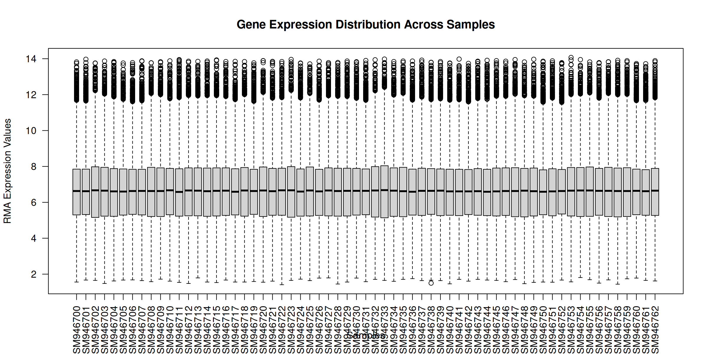
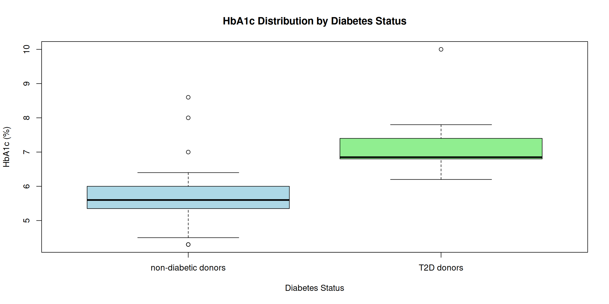
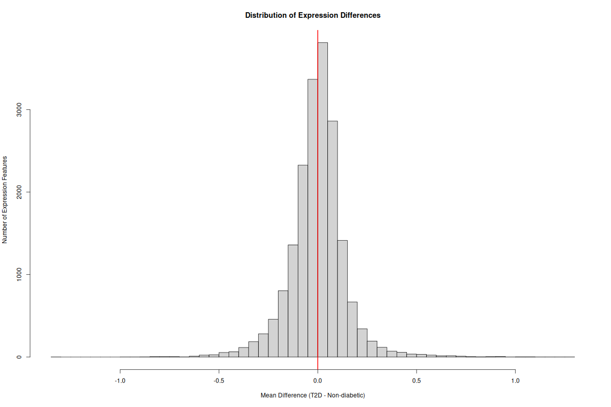
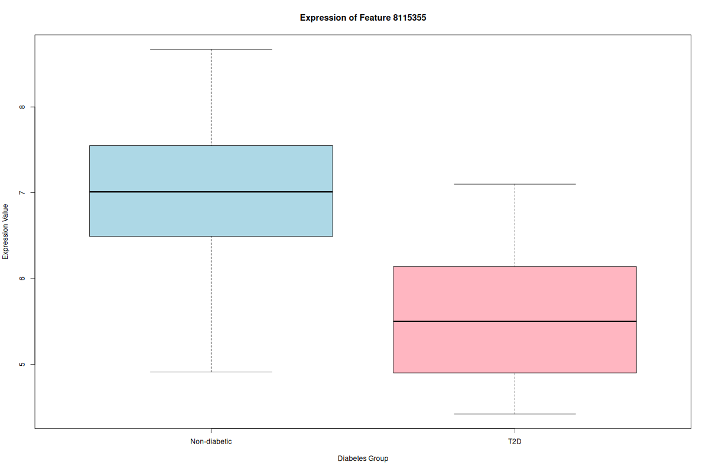

# Project Findings

## Stage 1: Data Import

- Dataset: GSE38642 from GEO.
- Platform: GPL6244.
- Successfully imported the expression data and sample metadata.
- Expression matrix: 18,808 features × 63 samples.
- Saved the imported dataset as an RDS file for reuse.

## Stage 2: Data Inspection

### 2.1 Sample Characteristics

The dataset contains 63 pancreatic islet samples from two groups:

- Non-diabetic donors: 54
- Type 2 diabetes (T2D) donors: 9
- Female donors: 27
- Male donors: 36

The sample identifiers and their ordering were consistent between the expression matrix and sample metadata.

### 2.2 Clinical Data Inspection

Three clinical variables were examined: age, BMI and HbA1c.

**Data availability:**

| Variable | Available | Missing |
|---|---:|---:|
| Age | 63 | 0 |
| BMI | 63 | 0 |
| HbA1c | 51 | 12 |

The missing HbA1c values were initially represented by `"--"` in the metadata. These were converted to proper missing values (`NA`) before calculating statistics.

**Overall descriptive statistics:**

| Variable | Mean | Median | Minimum | Maximum |
|---|---:|---:|---:|---:|
| Age (years) | 56.67 | 57.0 | 26.0 | 75.0 |
| BMI | 26.32 | 26.1 | 17.6 | 36.9 |
| HbA1c (%) | 5.95 | 5.8 | 4.3 | 10.0 |

**Comparison by diabetes status:**

| Variable | Non-diabetic | T2D |
|---|---:|---:|
| Mean age (years) | 56.61 | 57.00 |
| Mean BMI | 25.95 | 28.50 |
| Mean HbA1c (%) | 5.70 | 7.29 |

The HbA1c averages are based on 43 non-diabetic and 8 T2D donors.

The descriptive comparison showed similar average ages between the groups, while the T2D group had higher average BMI and HbA1c values.

### 2.3 Investigation of Unusual HbA1c Values

During clinical data inspection, three samples labelled as non-diabetic donors were found to have HbA1c values above 6.5%.

| Sample ID | HbA1c (%) |
|---|---:|
| GSM946732 | 7.0 |
| GSM946735 | 8.6 |
| GSM946750 | 8.0 |

The original GEO metadata was checked and confirmed these values and their non-diabetic classifications. However, the reason for these classifications could not be established from the available dataset information.

The original diabetes-status labels were therefore retained without reclassification.

### 2.4 Expression Data Inspection

The expression matrix was examined to understand its structure and numerical properties.

- Dimensions: 18,808 expression features × 63 samples.
- Data type: numeric (double).
- Minimum expression value: 1.41.
- Maximum expression value: 14.07.
- Mean expression value: 6.59.
- Median expression value: 6.63.
- Missing expression values: 0.

The GEO dataset documentation indicates that the expression values had already been processed and normalised using Robust Multi-array Average (RMA).

### 2.5 Visual Inspection and Data Quality Checks

Three plots were generated and saved to examine the clinical and gene expression data distributions.

**1. Expression distribution across samples**

The expression boxplot showed broadly similar distributions across the 63 samples. Sample medians and interquartile ranges were relatively consistent, with no obvious sample displaying a major global shift in expression values.

File: `plots/expression_distribution.png`

**2. Age and BMI by diabetes status**

The clinical distribution plots showed that:

- Age distributions were broadly similar between the two groups.
- The T2D group had a higher BMI distribution, although there was considerable overlap between groups.
- BMI values showed some variation within both groups.

File: `plots/clinical_distributions.png`

**3. HbA1c distribution by diabetes status**

The HbA1c boxplot showed generally higher HbA1c values among T2D donors. However, three donors labelled non-diabetic had elevated HbA1c values, which prompted the investigation documented in Section 2.3.

File: `plots/clinical_HbA1c.png`

### Stage 2 Summary

The inspection established that the dataset contains 63 samples with 18,808 expression features, alongside clinical information for age, BMI and HbA1c. The expression data contained no missing values and showed broadly consistent distributions across samples. Clinical inspection revealed differences in BMI and HbA1c between the diabetes groups, as well as unusual HbA1c values in three non-diabetic-labelled samples.

These observations provide the basis for the subsequent data preparation and exploratory analysis stages.

## Stage 3: Data Preparation

### 3.1 Clinical Data Extraction

Extracted the relevant clinical variables from the original GEO metadata:

- Age
- BMI
- HbA1c
- Sex
- Diabetes status

The clinical dataset contains 63 samples and 6 columns, including sample identifiers.

### 3.2 Data Cleaning

- Converted Age, BMI and HbA1c from character to numeric values.
- Replaced missing-value markers (`"--"`) with `NA`.
- Preserved the 12 missing HbA1c measurements without removing samples.
- Converted diabetes status into a categorical factor with two groups: non-diabetic donors and T2D donors.
- Retained donor sex as a categorical variable.

### 3.3 Sample Alignment

Verified that sample identifiers in the clinical dataset matched the expression matrix in both number and order.

Both alignment checks returned `TRUE`.

### 3.4 Saving Prepared Data

Combined the expression matrix and cleaned clinical data into a single R list and saved it as:

`data/raw/GSE38642_prepared.rds`

The saved file was successfully reloaded and verified.

- Expression matrix: 18,808 features × 63 samples.
- Clinical data: 63 samples × 6 variables.

## Stage 4: Exploratory Data Analysis

### 4.1 Expression Summary Statistics

Calculated the mean, median and standard deviation of expression values across the 63 samples for all 18,808 expression features.

### 4.2 Comparison Between Diabetes Groups

Compared the average expression values of each feature between non-diabetic and T2D donors.

Identified the 10 features with the largest absolute differences in average expression.

Feature 8115355 showed the largest difference:
- Non-diabetic mean: 6.984
- T2D mean: 5.671
- Mean difference: -1.312

### 4.3 Distribution of Expression Differences

Most expression features showed relatively small differences between the two groups. The distribution was centred close to zero.

### 4.4 Individual Feature Comparison

Examined feature 8115355 using a boxplot. Its expression values were generally lower in the T2D group than in the non-diabetic group.

These observations are exploratory and do not establish statistical significance.

## Stage 5: Visualisation

Saved the final visualisations generated during exploratory analysis as PNG files:

- `expression_difference_histogram.png`
- `feature_8115355_boxplot.png`

The images are stored in `data/raw/`.
